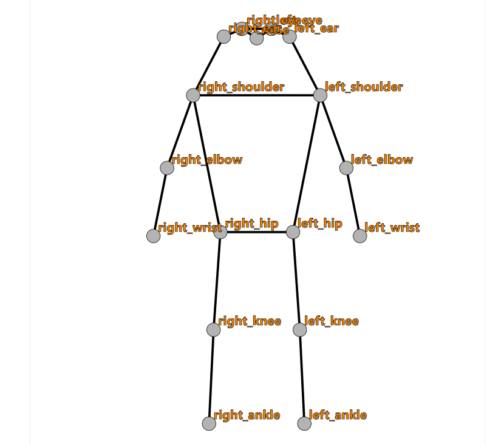
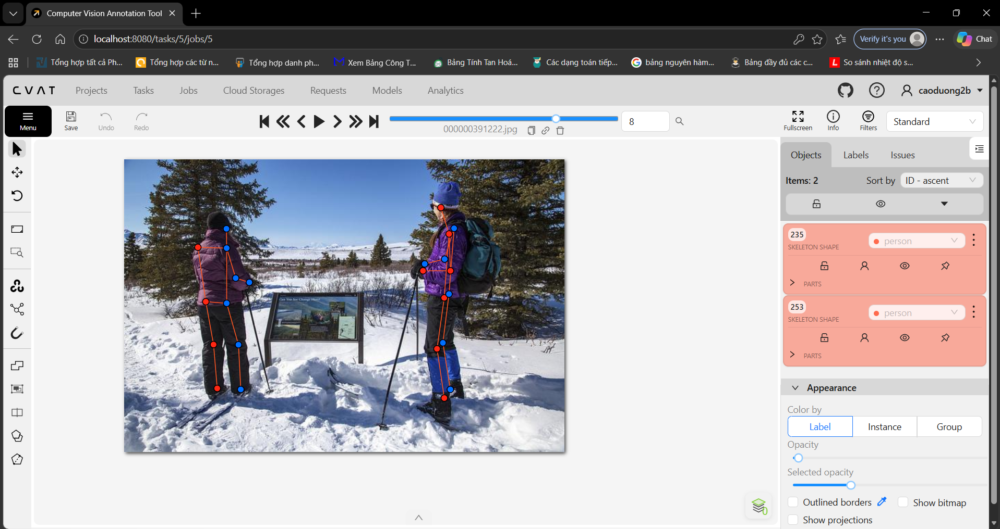
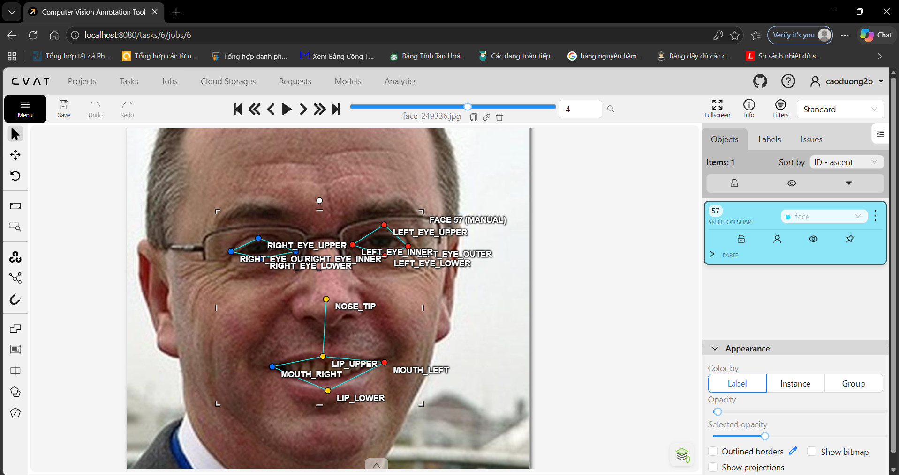
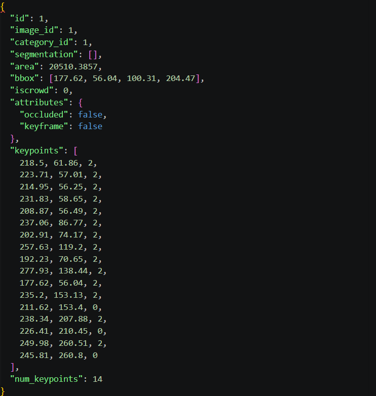

# Báo cáo cá nhân — HoVaTen-MSSV

Đổi tên file theo quy tắc `MSSV_HoTen.md`. Ví dụ: `20241234_NguyenVanAn.md`.

Dữ liệu: 12 ảnh người COCO val2017 (Lin et al., 2014) và 8 ảnh chân dung Wikimedia Commons, chỉ dùng trong lớp.

## 0. Thông tin học viên

- Họ tên: Cao Văn Dương
- MSSV: 2A202604056
- Email: 26ai.duongcv@vinuni.edu.vn
- Link repository:
- Phiên bản CVAT (Help → About):
- Máy: hệ điều hành Windows · RAM 8 GB · chạy CVAT chế độ lite
- Bộ ảnh (`src/exports/assignment.json` do `lab.py setup` tạo): có
- Giờ bắt đầu:16h00
- Giờ kết thúc: 19h30

## 1. Kiểm tra label (CP0)

| Label | Kiểu | Số điểm | Tên điểm đúng bảng của lab? | Đúng thứ tự? | Số cạnh |
|---|---|---:|---|---|---:|
| `person` |skeleton |17 |Đúng |Đúng |19 |
| `face` |skeleton |13 | Đúng |Đúng |13 |

Mẫu `person` dựng theo người quay mặt về camera (các điểm `left_*` nằm bên phải khung mẫu)? Có
Cách đổi cờ `occluded` / `outside` cho **một điểm** trên phiên bản CVAT này (một câu):Để thực hiện occluded sử dụng phím Q, còn outside sử dụng phím O

...

## 2. Số lượng đã gán và thời gian (CP1, CP2)

| Nhóm ảnh | Số ảnh | Số skeleton đã gán | Số người dưới 60 px (không gán) | Số poster / gương / màn hình bỏ qua | Thời gian (phút) |
|---|---:|---:|---:|---:|---:|
| `easy` | 5 |6 |0 |0 |10 |
| `occluded` | 3 |5 |1 |0|8 |
| `back` | 2 |4 |0 |0 |5 |
| `small` | 1 |1 |0 |0 |2|
| `crowd` | 1 |3 |1 |0 |3|
| `faces` | 8 |8 |0 |0 |15 |

- Số ảnh người đã xong ở mốc phút 105: 12 / 12
- Thời gian thực tế (phút): CP1 18 · CP2 15 · CP3 45
- Ảnh tốn thời gian nhất là ảnh 000000580257.jpg, vì ảnh đó xuất hiện việc hai người vắt chéo chân

...

## 3. Bảng ca khó (CP1, CP2)

Mỗi điểm bạn phân vân một dòng, nhất là phân vân giữa `v = 1` và `v = 0`, hoặc không chắc hướng người.

| Ảnh | Người / mặt | Điểm | Cờ đã chọn | Phân vân giữa | Lý do chọn |
|---|---|---|---:|---|---|
|000000381889 |Người |elbow |v=0|Phân vẫn giữa v = 1 và v = 0 |Bởi vì không đoán được hướng tay |
|face_333134 |Mặt |lower eyelid |v=2 |phân vân giữa v = 1 và v = 2 |Hơi khó dự đoán |


## 4. Bảng tự review (CP3)

Đi từ ảnh cuối về ảnh đầu. 5 ảnh người (ít nhất 2 ảnh `back` hoặc `crowd`) và 3 ảnh mặt. Ít nhất 8 dòng, kể cả dòng `ok`. Ghi lỗi trước, sửa sau.

Mã lỗi dùng đúng một trong: `lr_swap`, `vis_flag`, `position`, `missing`, `extra`, `ok`.

| Ảnh | Người / mặt | Điểm | Mã lỗi | Ghi chú | Đã sửa? |
|---|---|---|---|---|---|
|000000091637 |Người |left_shoulder |lr_swap	 |Em bé quay lưng, dễ đặt left_* ở bên trái khung hình như khi người đứng đối diện camera |Có |
|000000091637 |Người |nose| vis_flag|Mặt bị che hoàn toàn nhưng cờ đặt như điểm nhìn thấy, cần đặt theo quy tắc của lab cho điểm không thấy |Có |
|000000210604 |Người |right_wrist | position|Điểm cổ tay trôi gần đĩa bay thay vì nằm đúng cổ tay |Có |
|000000210604 |Người |left_ankle|missing |Chân đang nhảy và gần mép dưới, bàn chân giày đen vẫn thấy được nhưng bị bỏ sót khi gán |Có |
|000000391222 |Người | tất cả cặp left_* / right_*|lr_swap |Quay lưng hoàn toàn nên cả hai vai, hai hông, hai gối dễ bị đặt ngược |Có |
|face_13874 |Mặt |left_eye |vis_flag |Hai mắt nằm sau tròng kính tối, nên cờ phải theo quy tắc của lab cho mắt bị che. Dễ để mặc định nhìn thấy, trong khi chỉ đoán được vị trí |Có |
|face_185015 |Mặt |left_eye_upper, left_eye_lower, right_eye_upper, right_eye_lower |position |Mắt nhắm nên mi trên và mi dưới sát nhau. Các điểm upper và lower dễ chồng lên nhau hoặc lệch khỏi đường mí |Có |
|face_145621 |Mặt |left_eye_outer |missing |Khóe mắt ngoài nằm sát mép ảnh bên phải, dễ bỏ sót, hoặc phải đặt cờ ngoài ảnh theo quy tắc của lab |Có |

Tổng hợp số lỗi theo mã:8

| `lr_swap` | `vis_flag` | `position` | `missing` | `extra` | `ok` |
|---:|---:|---:|---:|---:|---:|
|2 |2 |2 |2 |0 |0 |

Điểm còn phân vân giữa `v = 1` và `v = 0` (ghi cả hai lựa chọn và lý do chọn):

000000381889.jpg cánh tay người đàn ông có thể v=1 nếu suy đoán được vị trí, v = 0 vì rõ ràng vị che khuất

## 5. Kiểm file xuất và kết quả tự kiểm (CP4)

Tự kiểm tay trong file JSON:

| File | Người / mặt kiểm (ảnh, thứ tự) | Số phần tử `keypoints` | Điểm `outside` ra `v = 0`, `occluded` ra `v = 1`? | `num_keypoints` khớp? |
|---|---|---:|---|---|
| `HoVaTen_persons.zip` |000000381889.jpg, người thứ 1 (annotation id 11)|51 |left_ear ra v = 0, left_elbow và left_wrist ra v = 1 |Khớp: 12 điểm có v > 0, num_keypoints = 12 |
| `HoVaTen_persons.zip` |000000091637.jpg, người thứ 2 (annotation id 2) |51 |left_ear ra v = 0, left_elbow và left_wrist ra v = 1 |Khớp: 12 điểm có v > 0, num_keypoints = 12 |
| `HoVaTen_faces.zip` |face_13874.jpg, mặt thứ 1 (annotation id 1) |39 |8 điểm hai mắt ra v = 1, 5 điểm còn lại v = 2. File không có điểm v = 0 nào nên không kiểm được outside trên mặt |Khớp: 13 điểm có v > 0, num_keypoints = 13 |

Sau khi xuất, CVAT ghi `occluded` thành `v = 1` và `outside` thành `v = 0`. Tọa độ của điểm `outside` trong file là  tọa độ cũ

Hai job đã chuyển sang completed trên CVAT? Có 

Dán phần **TÓM TẮT** in ra từ `src/check_submission.py`:

```text
 Số ảnh: 12 · số skeleton `person`: 19 · mỗi annotation 51 số
  Skeleton theo ảnh: 000000091637=2, 000000150192=1, 000000150500=1, 000000210604=2, 000000241837=1, 000000261732=1, 000000360811=2, 000000381889=3, 000000391222=2, 000000493741=1, 000000564304=1, 000000580257=2
  Cờ v: v=2 268 (83%) · v=1 3 (1%) · v=0 52 (16%)
  num_keypoints trung bình: 14.3
- File face: CaoVanDuong_faces.zip
  Số ảnh: 8 · số skeleton `face`: 8 · mỗi annotation 39 số
  Skeleton theo ảnh: face_13874=1, face_145621=1, face_155465=1, face_185015=1, face_249336=1, face_333134=1, face_359139=1, face_559185=1
  Cờ v: v=2 96 (92%) · v=1 8 (8%) · v=0 0 (0%)
  num_keypoints trung bình: 13.0
- Ghi chú: 52 điểm v = 0 vẫn mang tọa độ cũ (CVAT 2.x xuất như vậy; chuẩn COCO ghi 0, 0). Không phải lỗi: điểm v = 0 bị bỏ qua khi huấn luyện và khi chấm.
- Số [LỖI]: 0 · số [CẢNH BÁO]: 3
Kết quả: ĐẠT (đọc lại từng cảnh báo ở trên)
```


## 6. Ảnh chụp màn hình

1. Label `person` trong label constructor (đủ 17 điểm có tên):

   

2. Một người quay lưng đã gán, cờ đã đặt:

   

3. Một khuôn mặt đã gán 13 điểm, phóng to vùng mắt:

   

4. Một đoạn JSON xuất của một người:

   

Nguồn ảnh: COCO val2017 / Wikimedia Commons.

## 7. Tự đánh giá

1. Lỗi bạn mắc nhiều nhất hôm nay, và cách bạn sẽ tránh ở dự án thật:

   Đánh giá sai giữa v=0 và v = 1, xác đichh kỹ bám sát guideline

2. Một quy tắc bạn đề xuất thêm vào guideline (kèm ảnh ví dụ nếu có):

  Không có

3. Nhãn của bạn đi vào model ở đâu? Chọn một lỗi bạn đã sửa và nói nó sẽ làm model học sai thế nào (heatmap, trọng số trong loss, hay bước lật ảnh):

   

## 8. Khó khăn và lỗi kỹ thuật

...

## Bonus (nếu làm)

### B1 — 3 ảnh người khó thêm

| Ảnh | Số skeleton | Số người dưới 60 px | Ca khó nhất |
|---|---:|---:|---|
| | | | |
| | | | |
| | | | |

Kết quả `src/check_submission.py` cho `HoVaTen_bonus_persons.zip`:

```text
(dán ở đây)
```

### B2 — 5 ảnh khuôn mặt đen trắng / hồng ngoại

Ảnh không màu khó hơn ở điểm nào? Kính râm trên ảnh hồng ngoại có còn là `v = 1` không?

...

### B3 — Model so với nhãn của tôi (không tính điểm)

- Demo đã dùng:
- Ảnh đã thử:

1. Model có trả điểm cho khớp bị che, hay khớp ngoài ảnh không? Confidence ở các điểm đó thế nào?

   ...

2. Với người quay lưng, model có đổi trái/phải không?

   ...

3. Bộ điểm của model có giống 17 điểm COCO không?

   ...

## 9. Tài liệu tham khảo và công cụ AI đã dùng

Claude - 
